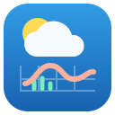
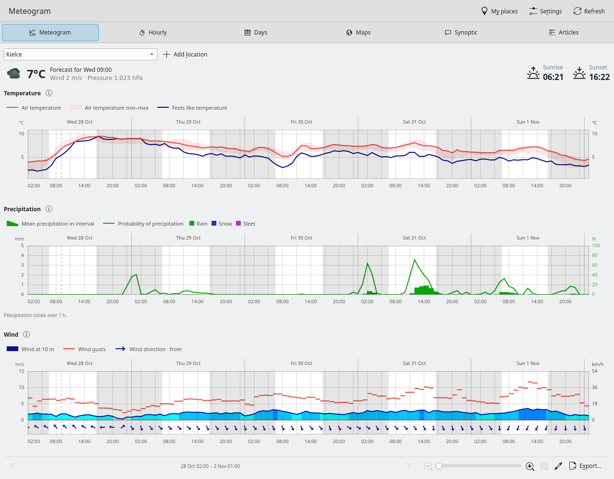

<p align="center">
  
</p>

# Meteo

[](https://github.com/kapiwko/meteo-pl/actions/workflows/tests.yml)
[](https://github.com/kapiwko/meteo-pl/actions/workflows/portable-packages.yml)
[](LICENSE)

Explore ICM UW weather forecasts from [meteo.pl](https://app.meteo.pl/meteogram)
in a Qt 6 / Kirigami application and a KDE Plasma 6 widget. Read detailed
meteograms, compare hourly and daily forecasts, and animate weather maps
without leaving your desktop.

[](docs/images/meteogram.png)

## What You Get

- Interactive charts for temperature, precipitation, wind, pressure, clouds,
  visibility, fog and storm indicators, with an optional parameter probe.
  On touchscreens, pinch to zoom, swipe horizontally to move through time,
  and double-tap to restore the full forecast. Vertical swipes scroll the charts.
- UM4 forecasts for Poland and Central Europe, and global GFS forecasts.
- A shared list of saved places: search for a town, choose a point on the map,
  enter coordinates or use the system location service.
- Custom chart profiles with mixed series, axis ranges, colors, drawing styles,
  chart order and individual heights. Import and export profiles as JSON.
- PNG export of selected charts as one image, plus PNG and CSV export of readings.
  Right-click a chart to save it individually or toggle series with checkboxes;
  these controls share the legend's visibility state and preserve axis ranges.
- Interactive map layers and thematic maps with buffered loading and animation
  preloading, so the previous map stays visible while the next frame loads.
- Synoptic commentary and articles from meteo.pl.
- Persistent caches for forecasts, map tiles, articles, illustrations and place
  searches, with disk usage and clearing controls in Settings.
- GPU rendering by default, an optional CPU renderer, and automated visual
  comparisons between both renderers.

## Install

This project is under active development. GitHub Actions builds downloadable
artifacts; there is no stable release yet. Open a successful run in
[Actions](https://github.com/kapiwko/meteo-pl/actions) and download the artifact
for your system. Each package directory includes SHA-256 checksums and a build
report.

| System | Package | Includes the Plasma widget |
| --- | --- | --- |
| Arch Linux | `.pkg.tar.zst` | Yes |
| Debian 13 / Ubuntu 26.04 | `.deb` | Yes |
| Fedora 44 | `.rpm` | Yes |
| Windows | Craft installer / archive | No |
| macOS | Craft application bundle | No |
| Android arm64 | APK | No |

Windows and macOS bundles include Qt and KDE dependencies. Android builds
include a development APK signed with a temporary test key. The Windows portable
ZIP and unsigned Android APK are available with `--include-alternatives`, or the
matching option when running the workflow manually. Development APKs built in different runs may require uninstalling the
previous build. The Android package has been built and inspected; device testing
is still needed.

### Linux Packages

```bash
# Arch Linux
sudo pacman -U ./meteo-pl-0.1.0-1-x86_64.pkg.tar.zst

# Debian / Ubuntu
sudo apt install ./meteo-pl_0.1.0-1_amd64.deb

# Fedora
sudo dnf install ./meteo-pl-0.1.0-1.x86_64.rpm
```

Start **Meteo** from your application launcher, or run `meteo-pl`.

### Plasma Widget

After installing a Linux package, open **Add Widgets…**, find **Meteo** and drag
it onto your desktop or panel. Its panel icon follows the forecast weather.
By default, the popup shows every enabled chart in the Classic ICM profile for
the next 24 hours. Open the widget settings → **Widget view** to choose a profile
and a 12/24/48/72-hour interval or the entire forecast. You can
also choose a compact daily forecast. The popup uses Plasma's standard container;
**Show meteogram** opens the full application in a separate window for the selected location.
Each widget keeps its own view configuration independently of the application.
The widget's context menu provides **Refresh**, **Show meteogram** and Plasma's
standard configuration action; these are also available from its header menu.
In **Places in this widget**, select and reorder a subset of your saved places.
This affects only that widget; names and coordinates remain shared with the app.
Wind, pressure, sunrise and sunset appear directly in the forecast header.
Each chart expands independently using Plasma's native list controls.
Its expanded state is remembered for each widget.

### KRunner

On Linux, type **pogoda Gdańsk**, **weather London**, or **meteo** in KRunner.
Saved places are matched locally, including names typed without Polish accents.
New places use the same worldwide search and disk cache as the application.
Selecting a result opens a full Meteo window for that location. The plugin can
be disabled with `-DMETEO_BUILD_KRUNNER=OFF` when configuring the build.

You can also preview the installed widget in its own window:

```bash
plasmawindowed pl.meteo.desktop
```

The widget uses the shared C++ QML module. Installing the QML package with
`kpackagetool6` alone is insufficient. A new Plasma session may be needed after
the first installation for Plasma to discover the module.

## Quick Start

1. Open **Location** and search for your town or choose a point on the map.
2. Choose **UM4** for Central Europe or **GFS** for worldwide coverage.
3. Switch between **Meteogram**, **Hourly**, **Days**, **Maps**, **Synoptic** and
   **Articles** using the navigation tabs.
4. Open **Settings** to choose a chart profile, forecast run, units or renderer.
5. Enable the pipette in the chart status bar to inspect values. Click a chart
   to pin the reading; use **Export…** to save selected charts together.

On Android, Material controls follow the system theme. The bottom bar switches
between **Forecast**, **Maps** and **News**. Forecast contains the meteogram,
hourly and daily views; News contains synoptic commentary and articles. Tap the
hourly view for a vertically scrolling forecast with temperature, rain, wind
and pressure; tap an hour to inspect all available parameters. Tap the
place name in the app bar to switch saved places. The overflow menu opens
location search and full-page settings, grouped into forecast, profiles,
readings and application preferences. Desktop and Plasma retain their existing UI.

Forecasts refresh hourly. **Refresh** requests fresh data immediately. If the
network is unavailable, saved data remains visible with its retrieval time.
Availability of individual parameters depends on the forecast model.

## Build From Source

Requirements: CMake 3.25+, Ninja, a C++23 compiler, Qt 6.5+ and KDE Frameworks 6.
Qt modules: Core, Network, Qml, Quick, QuickControls2, Positioning, Widgets and
Test. KDE dependencies: Kirigami, Notifications, KI18n and QQC2 Desktop Style.
GNU gettext tools are required to compile translations. The
widget additionally requires Plasma 6 and its QML modules.
The optional Linux search plugin requires the KF6 Runner and Config development packages.

```bash
git clone https://github.com/kapiwko/meteo-pl.git
cd meteo-pl
cmake --preset dev
cmake --build --preset dev --parallel 2
ctest --preset dev
./build/dev/apps/meteo/meteo-pl
```

For a system installation, use a separate release build:

```bash
cmake -S . -B build/release -G Ninja \
  -DCMAKE_BUILD_TYPE=Release -DCMAKE_INSTALL_PREFIX=/usr -DBUILD_TESTING=OFF
cmake --build build/release --parallel 2
sudo cmake --install build/release
```

`METEO_BUILD_APP` and `METEO_BUILD_PLASMOID` control the two frontends.
`METEO_QML_INSTALL_DIR` overrides the shared module installation directory.

When `plasmawindowed` is available, CTest also hosts the real widget in isolated
Plasma sessions. A local synthetic weather service covers loading, empty and
failed requests, offline cache, keyboard expansion, saved-place selection and
opening the desktop application. These tests leave screenshots, logs and request
traces in `build/dev/tests/plasma-artifacts`; CI publishes them with test reports.

## Documentation

- [User guide — Polish](docs/user-guide.pl.md): profiles, maps, exports and cache
  behavior.
- [Linux packaging and CI](docs/packaging.md): isolated distribution builds and
  installation checks.
- [Windows, macOS and Android builds](docs/portable-packages.md): Craft bundles,
  SDK setup and package limitations.
- [CPU/GPU visual tests](docs/renderer-tests.md): comparison coverage and how to
  run the tests.
- [Chart parity](docs/chart-parity.md): correspondence with the web client and
  parameter availability.
- [Translations](docs/translations.md): English source messages and gettext
  catalogs, including the Polish translation.
- [Architecture](docs/architecture.md): shared backend and frontend structure.

Preferences and saved places are stored in
`$XDG_CONFIG_HOME/meteo-pl/desktop.ini` (normally
`~/.config/meteo-pl/desktop.ini`). Cached data lives in
`$XDG_CACHE_HOME/meteo-pl` (normally `~/.cache/meteo-pl`). Each widget keeps its
selected location in the standard Plasma configuration.

## Forecast Sources

Forecasts and map images come from **ICM UW / meteo.pl**; the UM model is
provided by the **Met Office**. This is an independent client using the web
application's data interface, which may change. Weather data and third-party
libraries retain their own terms. See the
[meteo.pl terms](https://www.meteo.pl/regulamin-aplikacji-meteo-icm).

The project does not yet implement every feature of the Android app: observed
radar, FLOPRES, weather alerts and account/subscription integration are not
available. Precipitation maps show model forecasts. The numeric interface does
not expose a separate convective precipitation total.

## License

Copyright © 2026 **Kamil Piwowarski** · [kapiwko@gmail.com](mailto:kapiwko@gmail.com).

Licensed under **[GNU GPL version 3 or later](LICENSE)**
(`GPL-3.0-or-later`).
