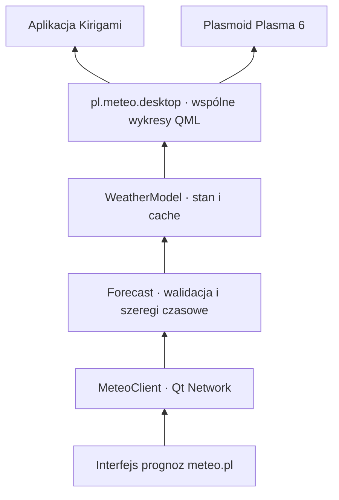

# Architektura

Wspólny backend C++ obsługuje aplikację okienkową i plasmoid. Inspiracją jest
podział odpowiedzialności z `btrfs-backup`, zwłaszcza wspólne modele prezentacji
i osobny pakiet integracji KDE. Pogoda nie wymaga procesu systemowego,
uprawnień roota ani pośrednictwa D-Bus.

| Katalog | Odpowiedzialność |
| --- | --- |
| `src/core` | Dokument prognozy, walidacja współrzędnych i obszaru modelu, wybór najnowszego uruchomienia |
| `src/network` | Asynchroniczne HTTP, timeout, limity, anulowanie i cache obrazów |
| `src/presentation` | Modele prognoz, wyszukiwarki, map i treści redakcyjnych; jednostki i preferencje |
| `src/qml` | Wykresy z inspektorem, edytor lokalizacji, mapy, prognoza godzinowa i dzienna |
| `apps/meteo` | Okno Kirigami, preferencje użytkownika i wpis desktop |
| `integrations/plasma` | Pakiet Plasma 6, konfiguracja instancji i kompaktowa reprezentacja |
| `tests` | Parser, lokalny serwer HTTP, cache, renderowanie QML i start aplikacji |

## Przepływ danych

1. Model sprawdza cache przypisany do modelu i dokładnych współrzędnych.
2. Dla cache młodszego niż godzina, obejmującego bieżącą chwilę, nie powtarza
   automatycznego pobrania. Ręczne odświeżenie pomija ten warunek.
3. `GET /meteorograms/available` zwraca daty uruchomień. Adapter wybiera maksimum
   lub żądany start archiwalny, po sprawdzeniu jego dostępności.
4. `POST /meteorograms/{model}` z `point.lat`, `point.lon` i `date` zwraca prognozę.
5. Parser sprawdza dane i osobne osie czasu wszystkich szeregów. Braki danych
   zachowuje jako `null`; nie zamienia ich w zero.
6. `WeatherModel` przelicza ciśnienie z Pa na hPa i zachmurzenie z ułamka na %,
   wiatr na wybraną jednostkę i widzialność na km. Podstawy chmur sprawdza według
   jednostki źródłowej (serwis zwraca też km).
   Opad jest podawany w mm dla przedziału prognozy. Nie zakłada godzinnego
   przedziału dla modeli o innej rozdzielczości czasowej.
7. Dopiero poprawna odpowiedź zastępuje stan i cache przez `QSaveFile`.

Zmiana lokalizacji anuluje poprzednie żądanie i usuwa poprzednie podsumowanie,
zanim rozpocznie się nowe pobranie. Licznik generacji odrzuca spóźnione odpowiedzi.
Jedna instancja `WeatherModel` obsługuje wszystkie wykresy danego widoku.

`ForecastFields` definiuje dane i katalog serii. `ChartConfiguration` buduje
gotowe konfiguracje oraz normalizuje zapisy użytkownika. Każdy wykres ma nazwę,
listę dowolnych serii, przypisania do osi, opcjonalne granice osi oraz style
kolorów, linii, punktów i wypełnień. `UserPreferences` przechowuje pełną
konfigurację w nazwanych profilach; stare listy kluczy są migrowane przy odczycie.
`WeatherModel::configuredCharts` wiąże konfigurację z dostępnymi seriami,
przelicza jednostki i ustala automatyczne przypisanie do dwóch osi.
`ForecastPanel` składa widok według profilu. `Meteogram` używa rodzajów rysowania
i skal z konfiguracji, a `MeteogramStyle.js` zawiera skale i palety ICM.
`SeriesLegend` pokazuje tę samą próbkę w legendzie i w edytorze wyglądu.
`MeteogramStyle.paintChart` emituje wspólne polecenia rysowania. Domyślny
`GpuPlot` zamienia je na trójkąty `QSGGeometryNode` z kolorami wierzchołków
i przekazuje do RHI Qt Quick; etykiety są elementami `Text`, a warstwa ma
MSAA 4×. W tej ścieżce nie powstaje obraz wykresu na CPU. Alternatywny
`Canvas.Image` jest wybierany w preferencjach lub automatycznie, gdy scena
Qt Quick używa backendu programowego. Zmiana renderera działa bez restartu.
Wskaźniki kursora mają osobną geometrię; ruch myszy nie przebudowuje serii,
siatki ani etykiet. Test na rzeczywistym RHI sprawdza również ten warunek.
Edytory wykresów i serii są tworzone dopiero po rozwinięciu.
Wysokość wykresu dziedziczy ustawienie profilu, a następnie wartość ogólną.
Globalna preferencja legendy określa stan początkowy; przycisk przy tytule
przełącza ją lokalnie bez zapisywania w profilu. Dolny pasek `ForecastPanel`
obsługuje zakres i powiększenie z minimalnym przedziałem 24 godzin.
Wspólne okno `MeteoSettings` dla aplikacji i plasmoidu zawiera selektory
profilu, okresu i uruchomienia modelu oraz edytor wyglądu i preferencje globalne.
Otwiera je jeden przycisk „Ustawienia” w górnym pasku.
`ChartExporter` przechwytuje wybrane wykresy osobno przez `QQuickItem::grabToImage`,
niezależnie od pozycji przewijania, i składa PNG z podpisami i źródłem.
Przejściowy tryb eksportu ukrywa przyciski i odczyt kursora bez zmiany układu.
Zapis jest atomowy przez `QSaveFile`; błąd lub zmiana widoku przywraca stan
wykresów. Limit 64 megapikseli ogranicza zużycie pamięci. Wybór pliku korzysta
z dialogu platformy Qt, z natywną integracją KDE wymagającą `QApplication`.
Import i eksport korzystają z lokalnych plików JSON w formacie
`pl.meteo.chart-profiles`, wersja 1. Zapis jest atomowy (`QSaveFile`). Import
sprawdza cały dokument przed zmianą ustawień, normalizuje style, nadaje nowe
identyfikatory i rozróżnia powtarzające się nazwy. Jeden plik może zawierać
do 100 profili i mieć do 16 MiB. Plik ustawień jest wskazany w edytorze;
domyślnie to `~/.config/meteo-pl/desktop.ini`.
Tła i zakresy min–max poprzedzają linie
i znaczniki, mgła jest ponad pokryciem chmur, siatka ponad wypełnieniami,
a odczyt kursora na wierzchu. Ukrycie serii przez legendę nie przelicza osi.
Temperatura przy gruncie jest przedstawiana pionowymi kreskami min–max
dla wspólnych znaczników czasu obu serii, ponad liniami temperatury powietrza.
Tło temperatur poniżej zera jest ograniczone położeniem 0°C, także przy
całkowicie ujemnym lub dodatnim zakresie.

Pola opadu konwekcyjnego nie ma w obecnym dokumencie liczbowym. Przekroczenie
skali przez maksimum opadu lub poryw ma osobny czerwony znacznik.
Opcjonalne serie GFS przesłane jako `null` są pomijane; ich brak nie odrzuca
pozostałej prognozy. Brak temperatury głównej nadal jest błędem dokumentu.

Cache prognoz jest wspólny dla procesów i zawiera model, współrzędne, żądany
start, czas pobrania oraz oryginalny dokument. Klucz to SHA-256 modelu
i współrzędnych, z osobnym sufiksem dla archiwum.
Odczyt sprawdza również zawartość nagłówka i dokumentu. Awaria cache nie blokuje
pobrania ani wyświetlenia prognozy. Instancje uruchomione równocześnie mogą
wykonać osobne żądania; ta wersja nie współdzieli trwających pobrań między procesami.

## Mapy i wyszukiwanie

`PlaceSearchModel` odpytuje NOM dla Polski i Photon dla świata, z opóźnieniem
350 ms i odrzucaniem spóźnionych wyników. `Locations` waliduje obydwa formaty.
`UserPreferences` zapisuje ulubione, ostatnie miejsca i ustawienia wykresów.

`WeatherLayersModel` pobiera opublikowane starty z `/json/UM4_min_max.json`
lub `/json/GFS_min_max.json`, a następnie tworzy żądania WMS w EPSG:3857.
`TileMap` zamraża adresy i współrzędne kafelków dla każdej klatki.
`MapTileFrame` przechowuje poprzednią kompletną klatkę do przygotowania nowej;
położenie starej nadal wynika z bieżącego środka i skali mapy. Odrzucone lub
niekompletne klatki nie zastępują widocznej. `BufferedImage` zapewnia taką samą
podmianę pojedynczych map tematycznych. Zegar animacji pracuje tylko przy
gotowej klatce, a podpis czasu dotyczy obrazu widocznego na ekranie.

Singleton QML `MapImages` rejestruje asynchronicznego dostawcę obrazów w każdym
silniku QML. `ImageCache` współdzieli trwające pobrania i cache LRU obrazów
(96 MiB) w procesie. `QNetworkDiskCache` ma limit 256 MiB i osobny katalog
dla aplikacji oraz Plasma. Odpowiedzi mają deadline 25 s, limit 8 MiB i limit
16 megapikseli; dekodowanie odbywa się w puli dwóch wątków. Prefetch kolejnej
klatki używa tego samego magazynu i nie zmienia kroku aktualnie wyświetlanego.
`ImagePreloader` przed animacją przygotowuje całą pętlę, z limitem czterech
równoległych żądań. Licznik generacji odrzuca zakończenia anulowanego zadania;
zmiana warstwy, startu lub obszaru wymaga przygotowania nowej pętli.
Postęp i anulowanie są dostępne na mapie. Mapy tematyczne mają skalę bazową
dopasowaną do obu wymiarów widoku, niezależnie od proporcji obrazu.

`EditorialModel` pobiera komentarz synoptyka (także według daty) i stronicowane
artykuły. Daty przyszłe nie powodują żądania; HTTP 404 dla komentarza jest
prezentowane jako brak publikacji. Adaptery są oddzielone od QML, a ich adresy
można wstrzyknąć w testach.
Grafiki artykułów są skalowane przez `ResponsiveImages` do szerokości dokumentu,
z zachowaniem proporcji także po zmianie rozmiaru okna.

Plasmoid po rozwinięciu ładuje `CompactForecast` z podsumowaniem i równymi
kolumnami dni. Pełny `ForecastPanel` jest tworzony po przejściu do meteogramu.
Ikona panelu odpowiada pogodzie; własna ikona SVG służy jako ikona aplikacji
i zastępnik przy braku danych. Skrypt rejestracji wersji developerskiej zapisuje
wpis desktop i ikonę użytkownika wskazujące na plik wykonywalny z katalogu budowy.

## Weryfikacja

`ctest --preset dev` nie potrzebuje dostępu do serwisu meteo.pl. Testy HTTP
korzystają z lokalnego serwera TCP; testy interfejsu uruchamiają Qt w trybie
`offscreen`, z syntetyczną prognozą. Test aplikacji używa `--smoke-test`, który
wyłącza pobieranie. Test renderowania obejmuje wspólny panel używany przez obydwa
frontendy. Jeśli dostępny jest `plasmawindowed`, zestaw zawiera także test
uruchomienia pakietu plasmoidu. Zachowanie widgetu w panelu i zasobniku wymaga
osobnego sprawdzenia w sesji Plasma.

Testy map używają lokalnego serwera PNG z kontrolowanym opóźnieniem. Sprawdzają
zachowanie starej klatki do załadowania wszystkich kafelków, błędy i spóźnione
odpowiedzi, cache po restarcie bez serwera, przeliczanie współrzędnych w obu
półkulach oraz rzeczywiste przeciąganie i zoom pod kursorem. Obejmują też
przygotowanie animacji, anulowanie oraz dopasowanie szerokich map tematycznych.
Testy renderowania sprawdzają także stykanie się słupków opadu, widoczność mgły
nad chmurami i tło poniżej 0°C. Testy profili obejmują wybór serii, kolejność,
zapis i odczyt; selektor oryginalnego meteogramu jest testowany lokalnie.
