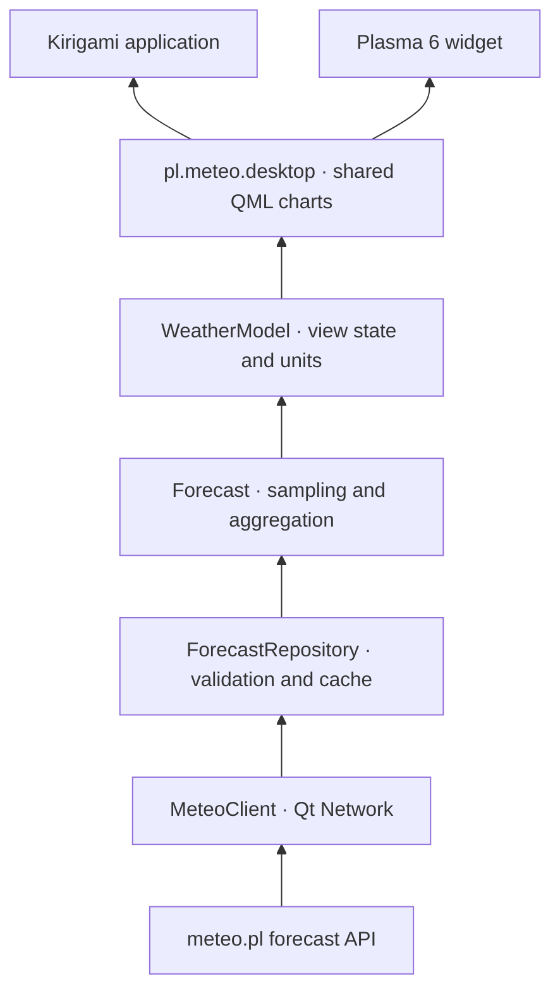

# Architecture

A shared C++ backend serves the desktop application and Plasma widget. The
separation follows `btrfs-backup`, particularly its shared presentation models
and separate KDE integration package. Forecast access needs no system daemon,
root privileges or D-Bus intermediary.

| Directory | Responsibility |
| --- | --- |
| `src/core` | Forecast document, coordinate/model coverage validation and latest-run selection |
| `src/data` | Forecast retrieval, validated results and persistent cache |
| `src/network` | Asynchronous HTTP, deadlines, limits, cancellation and image cache |
| `src/presentation` | Forecast, search, map and editorial models; units and preferences |
| `src/qml` | Charts and inspector, place forms, maps, hourly and daily forecasts |
| `apps/meteo` | Kirigami window, session preferences and desktop entry |
| `integrations/plasma` | Plasma 6 package, instance settings and compact representation |
| `tests` | Parsing, local HTTP fixtures, caches, QML rendering and application startup |

## Forecast data flow

1. `WeatherModel` asks `ForecastRepository` for cached data keyed by model,
   coordinates rounded to six decimals and requested run. HTTP requests and
   cache identity use the same canonical point.
2. Automatic retrieval reuses a cache entry younger than one hour if it covers
   the current time. Manual refresh bypasses this freshness check.
3. `GET /meteorograms/available` returns model-run dates. The adapter selects
   the latest or explicitly requested available historical run.
4. `POST /meteorograms/{model}`, with `point.lat`, `point.lon` and `date`, returns
   the forecast.
5. The parser validates the document and each series' individual time axis.
   Missing values remain `null` rather than becoming zero.
6. `WeatherModel` converts pressure from Pa to hPa, cloud fractions to percent,
   wind to the selected unit and visibility to km. Cloud-base conversion checks
   the source unit, which can already be km. Precipitation is in mm per source
   forecast interval; models with another time resolution are not treated as
   hourly data.
7. The repository returns a `ForecastSnapshot` containing the document,
   retrieval time, origin and source revision. Only a valid response replaces
   cached data through `QSaveFile`. Presentation models do not own forecast-file
   reads or writes.

Changing location cancels the previous request and clears its summary before
retrieval starts. A generation counter rejects late replies. One `WeatherModel`
serves all charts in a view.

`ForecastSampling` separates instantaneous values from quantities covering an
interval. Instantaneous values use the nearest source sample; precipitation
uses `[time, time + interval)`. Missing values remain missing. Suffixes such as
`_min`, `_max` and `_aver` often describe spatial statistics of neighboring grid
points and do not themselves determine time semantics. See the
[ICM system description](https://www.meteo.pl/faq-category/opis-systemu) and
[meteogram guide](https://www.meteo.pl/jak-czytac-prognoze-pogody-czesc-i-meteogramy).
Rules are assigned explicitly to fields.

`ForecastFormatting` describes samples consistently in readings and hourly
tables. Precipitation totals identify their source interval even when repeated
in several rows. `ChartDataBuilder`, readings and CSV share this contract;
readings identify source times or intervals and markers align with their source
samples. `ForecastAggregation` computes daily values from original intervals,
including daylight-saving transitions. `ChartAnalysis` bounds tick counts even
for extreme limits in imported profiles. A minute timer updates the summary
without changing the data revision or rebuilding chart geometry.

## Profiles, preferences and rendering

`ForecastFields` defines data fields and the series catalog. `ChartConfiguration`
builds configurations and normalizes user settings. Each chart stores a title,
series list, axis assignments, optional bounds and styles for colors, lines,
points and fills. `UserPreferences` exposes complete named profiles.

`PreferencesStore` owns the INI file, migration and notifications for local and
cross-process changes. Each mutation takes an interprocess lock, reloads the
latest file, changes the relevant collection and writes atomically. Public state
and notifications change only after success; errors appear in the standard
settings notice. Independent place and profile operations preserve both
changes. Stable place IDs survive edits and coordinate changes. A deleted place
cannot be recreated by saving a stale editor; explicit deletion can be undone.
Legacy keys migrate while preserving profiles and places.

`WeatherModel::configuredCharts` delegates to `ChartDataBuilder`, which binds
configuration to available series and assigns units to two axes. A third
incompatible automatic unit produces an explicit conflict notice. Configuration
is retained so the user can assign axes. Ranges join by exact timestamps while
preserving gaps; storm and lightning intervals are combined. Precipitation
geometry uses each sample's native start and end.

`ForecastPanel` assembles the configured profile. `Meteogram` uses configured
renderers and scales; `MeteogramStyle.js` implements ICM scale/palette handling.
`SeriesLegend` shares its preview between legends and appearance editors.
`ChartConfiguration` restricts special renderers to compatible quantities;
the editor and import normalization use the same catalog. `DailyForecastView`
assembles day cards, and `WeatherModel::chartExportMetadata` supplies shared PNG
metadata.

`MeteogramStyle.paintChart` emits shared drawing commands. The default `GpuPlot`
converts them into vertex-colored `QSGGeometryNode` triangles for Qt Quick RHI.
Labels use `Text` items and the layer has 4× MSAA. This path does not rasterize
the plot to an image on the CPU. The alternative `Canvas.Image` is selected in
preferences or automatically when Qt Quick uses its software backend. Renderer
changes take effect without restarting. Cursor indicators have separate
geometry: pointer movement does not rebuild series, grid or labels. An actual
RHI test verifies this behavior. Chart/series editors are created lazily.

Chart height inherits from the profile, then the global preference. The global
legend preference controls initial visibility; title buttons toggle it locally
without changing profiles. The bottom status bar controls range and zoom with a
minimum 24-hour interval, clamped to shorter forecasts. Preset intervals start
at the first forecast hour; mobile starts with the first 72 hours.

Desktop `MeteoSettings` groups current-forecast controls and global preferences.
Android uses settings pages in a standard `StackView`. Profile editing has its
own selected profile and changes the forecast only through **Use for forecast**.
Scoped undo rejects a conflicting later edit to the same profile while preserving
unrelated changes. Axis drafts remain visible until valid bounds can be saved
atomically. `ForecastSession` owns each window's state and `QtCore.Settings`
selection, shared by `ForecastWindow` and `Mobile`. Plasma/KRunner previews stay
temporary until explicitly selected. `SolarCalendar` supplies day/night icons,
backgrounds and sunrise/sunset. Model-run labels use the selected time zone.

## Export and configuration storage

`ChartExporter` captures selected charts individually through
`QQuickItem::grabToImage`, regardless of scroll position, and composes a labeled
PNG with source attribution. Temporary export mode hides controls and cursor
readings without changing layout. `QSaveFile` writes atomically. Export checks
data, style, range and legend revisions before and after each capture. A change
cancels the operation, preserves an existing file and restores chart state.
A 64-megapixel limit bounds memory. Qt platform file dialogs provide native
selection; KDE integration requires `QApplication`.

`ProfileFileCodec` imports/exports local JSON in `pl.meteo.chart-profiles`
format version 1. Writes are atomic. Import validates the entire document before
mutating settings, normalizes styles, creates fresh IDs and disambiguates names.
A file can contain up to 100 profiles and 16 MiB. **About → Technical details**
shows the settings path, normally `~/.config/meteo-pl/desktop.ini`.

Factory profiles in `resources/profiles` and catalogs in `resources/charts` are
the single source of default chart configuration: colors, renderers, layers,
backgrounds, fill palettes and axes live in JSON. The Draft 7 schema is
`resources/schemas/chart-data.schema.json`. CMake fetches Valijson from a pinned
archive with a SHA-256 digest; resource loading and import use the same schema
without fetching external schemas. JSON files and schema are also installed in
`share/meteo-pl`.

Factory edits are stored as ID-based overrides in the atomic preference store.
Deleted presets have an ID list; restoration reloads factory resources. Legacy
Custom layout storage remains supported. A one-time migration removes only
unmodified, disabled templates from older profiles.

Backgrounds and min–max fills precede lines and markers; fog sits above cloud
cover, the grid above fills and cursor readings on top. Legend toggles do not
recompute axes. Ground temperature uses vertical min–max stems at timestamps
shared by both bounds, above air-temperature lines. Subzero shading is clipped
to 0°C even when the whole range is positive or negative.

The current numeric document has no separate convective-precipitation field.
Off-scale precipitation maxima and gusts have distinct red markers. Optional
GFS series returned as `null` are omitted without rejecting the rest of the
forecast. Missing primary temperature remains a document error.

The forecast cache is shared across processes. Entries contain the model,
coordinates, requested run, retrieval time and original document. Keys hash the
model and coordinates with an archive suffix. Reads validate both header and
document. Cache failure does not block network retrieval or display. Concurrent
processes can issue separate requests; this version does not share in-flight
forecast requests across processes. Storage is limited to 128 MiB and 256
entries, with retention accounting for recent reads.

## Maps and place search

`PlaceSearchModel` queries NOM for Poland and Photon worldwide with a 350 ms
debounce and stale-result rejection. `Locations` validates both formats.
`UserPreferences` exposes the shared saved-place collection.
`SavedPlaceController` tracks each view's selection independently and follows
renames, moved coordinates and deletion. The selected place remains in the app
or Plasma instance configuration. A shared coordinate rule retains the existing
tolerance. Fresh views wait for an explicit choice.

`MeteoMapSource` validates published runs from `/json/UM4_min_max.json` or
`/json/GFS_min_max.json` and builds EPSG:3857 WMS requests. `WeatherLayersModel`
owns the layer, run and valid step. `MapLegendModel` retrieves
`legend_style.json` and `layers_legend.json`; `MapLegend` displays their colors,
thresholds and units directly on the map. Layer changes reuse the catalog without
a WMS legend image. `ThematicMapSource` separates UM/WAM URLs and publication
timing from presentation.

`TileMap` freezes tile URLs and coordinates per frame. `MapTileFrame` keeps the
previous complete frame until its replacement is ready; that old frame still
follows the current center and zoom. Discarded or incomplete frames never replace
the visible one. `BufferedImage` provides the same behavior for thematic maps
with two persistent image items. The next PNG prepares underneath the current
one, with an opaque background separating transparent regions. Basemap and label
tiles share active textures between forecast steps. The clock attempts a frame
change every 500 ms, skipping attempts while loading without restarting the
whole interval. The timestamp always describes the visible image.

The QML `MapImages` singleton registers an asynchronous image provider in every
QML engine. `ImageCache` shares in-flight requests and a 96 MiB decoded-image LRU
within the process. `QNetworkDiskCache` has a 256 MiB limit and separate app and
Plasma directories. `QLockFile` permits one owner per directory; another process
uses RAM and network without opening the same disk store. Requests have a
25-second deadline, 8 MiB response limit and 16-megapixel image limit. Two worker
threads decode images. Prefetch uses the same store without changing the visible
step. Images without explicit server freshness receive 30 minutes on disk too,
so leaving the RAM LRU does not force a full animation download. Explicit server
cache restrictions are respected.

`ImagePreloader` prepares the full thematic loop by default. Interactive maps
start once the current frame and next two frames are ready, with the rest loading
in the background. Ordering starts at the selected step and wraps at the end.
A shared four-task budget covers downloading and waiting for decoding across
consumers. Cancellation removes only the view's subscription, preserving work
needed elsewhere. Generation counters reject canceled completions. Changing
layer, run or area requires preparing a new loop. Progress and cancellation are
on the map. Thematic maps fit both viewport dimensions regardless of aspect ratio.

## Editorial content and cache management

`EditorialModel` retrieves dated synoptic commentary and paginated articles.
Future dates issue no request; commentary HTTP 404 means no publication.
Adapters are separate from QML and accept injectable endpoints in tests.
Atomic `editorial` entries are keyed by complete URL (date/page). Reopening uses
cached content for 30 minutes; manual refresh forces network access. Failed
refresh preserves content. Article pages replace earlier pages without duplicate
entries; retry targets the failed page. Validation precedes state/cache updates.
Storage is limited to 32 MiB and 256 entries. Illustrations and thumbnails use
`ImageCache`. `ResponsiveImages` fits article illustrations to document width
while preserving aspect ratios after window resizing.

`JsonRequest` optionally caches full-URL responses in `metadata`: place queries
for 24 hours and model-run catalogs for five minutes. Limits are 512 entries and
32 MiB. Request generations also reject stale asynchronous cache completions.
JSON and forecast transports share size, inactivity and total-time limits;
a slow transfer cannot extend the deadline indefinitely.

`CacheStorage` measures and clears only the cache directory in the background,
without following symlinks. Clearing also resets image RAM and write generations
so older in-flight work cannot restore deleted content. Settings and profiles
remain in a separate configuration directory.

## Plasma integration

The widget embeds `ForecastPopup` in a standard Plasma container. Its chart view
shows every enabled chart in the selected profile as an independently collapsible
section; an alternative view shows compact daily forecasts. Profile, time window,
collapsed sections, active place and place filtering/order belong to each widget
instance. Units, UTC, profile catalog and saved places are shared.

The pin action and **Keep open** toggle native `hideOnWindowDeactivate`, persisted
per instance. Native Plasma configuration pages control widget places and layout
and provide access to shared preferences. **Show meteogram** launches a separate
full application window. `WidgetForecast` remains exported for older consumers;
the current host does not load it. The panel icon follows forecast conditions;
the custom SVG identifies the application and serves as a no-data fallback.
The development-registration script installs a user desktop entry and icon
pointing at the build-directory executable.

## Verification

`ctest --preset dev` does not need meteo.pl access. HTTP tests use a local TCP
server; UI tests use Qt's `offscreen` platform and synthetic forecasts. The
application's `--smoke-test` disables retrieval. Rendering tests cover the shared
panel used by both frontends. If `plasmawindowed` is available, the suite also
checks widget-package startup with refresh disabled in an isolated copy.
Interaction tests use a local server. Two real `ForecastPopup` instances verify
independent profiles, ranges and collapsed sections with shared units and UTC.
Panel/system-tray behavior still needs checking in a Plasma session.

Map tests use delayed local PNG responses to check old-frame retention, errors,
stale replies, disk-cache reuse after restart, both hemispheres, actual dragging,
zoom under the cursor, animation preparation/cancellation and wide-map fitting.
Rendering checks include adjacent precipitation bars, fog above clouds and
subzero shading. Profile tests cover series selection, ordering and persistence;
the original-meteogram selector is tested locally.

On Linux, RHI tests use virtual X11 through `xvfb-run` when available. This avoids
broken window-header capture in Qt 6.8's `offscreen` platform while preserving
the RHI requirement and image tolerances. Separate tests exercise actual RHI and
software backends and verify geometry semantics as well as image similarity.
CI installs every Linux package in a separate runtime image without compiler
headers; reports identify the exact artifact, SHA-256 and installation result.
