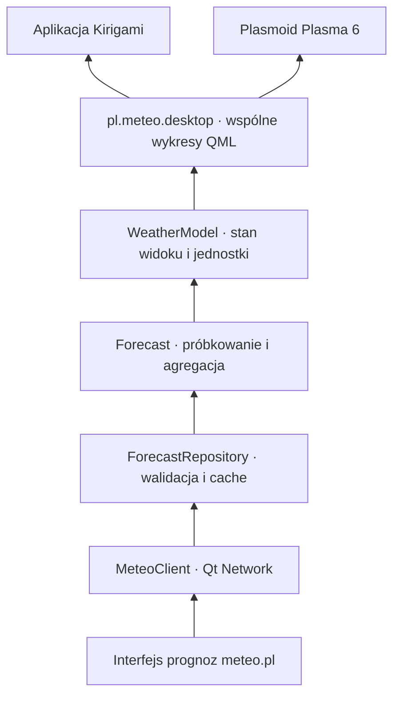

# Architektura

Wspólny backend C++ obsługuje aplikację okienkową i plasmoid. Inspiracją jest
podział odpowiedzialności z `btrfs-backup`, zwłaszcza wspólne modele prezentacji
i osobny pakiet integracji KDE. Pogoda nie wymaga procesu systemowego,
uprawnień roota ani pośrednictwa D-Bus.

| Katalog | Odpowiedzialność |
| --- | --- |
| `src/core` | Dokument prognozy, walidacja współrzędnych i obszaru modelu, wybór najnowszego uruchomienia |
| `src/data` | Pobieranie prognoz, walidowane wyniki i trwały cache |
| `src/network` | Asynchroniczne HTTP, timeout, limity, anulowanie i cache obrazów |
| `src/presentation` | Modele prognoz, wyszukiwarki, map i treści redakcyjnych; jednostki i preferencje |
| `src/qml` | Wykresy z inspektorem, edytor lokalizacji, mapy, prognoza godzinowa i dzienna |
| `apps/meteo` | Okno Kirigami, preferencje użytkownika i wpis desktop |
| `integrations/plasma` | Pakiet Plasma 6, konfiguracja instancji i kompaktowa reprezentacja |
| `tests` | Parser, lokalny serwer HTTP, cache, renderowanie QML i start aplikacji |

## Przepływ danych

1. `WeatherModel` pyta `ForecastRepository` o cache przypisany do modelu,
   współrzędnych zaokrąglonych do sześciu miejsc i żądanego startu. Ten sam
   punkt kanoniczny służy do zapytania HTTP i identyfikacji cache.
2. Dla cache młodszego niż godzina, obejmującego bieżącą chwilę, nie powtarza
   automatycznego pobrania. Ręczne odświeżenie pomija ten warunek.
3. `GET /meteorograms/available` zwraca daty uruchomień. Adapter wybiera maksimum
   lub żądany start archiwalny, po sprawdzeniu jego dostępności.
4. `POST /meteorograms/{model}` z `point.lat`, `point.lon` i `date` zwraca prognozę.
5. Parser sprawdza dane i osobne osie czasu wszystkich szeregów. Braki danych
   zachowuje jako `null`; nie zamienia ich w zero.
6. `WeatherModel` przelicza ciśnienie z Pa na hPa i zachmurzenie z ułamka na %,
   wiatr na wybraną jednostkę i widzialność na km. Podstawy chmur sprawdza według
   jednostki źródłowej (serwis zwraca też km).
   Opad jest podawany w mm dla przedziału prognozy. Nie zakłada godzinnego
   przedziału dla modeli o innej rozdzielczości czasowej.
7. Repozytorium zwraca `ForecastSnapshot` z dokumentem, czasem pobrania,
   pochodzeniem i rewizją źródła. Dopiero poprawna odpowiedź zastępuje cache
   przez `QSaveFile`; model widoku nie odczytuje ani nie zapisuje plików prognoz.

Zmiana lokalizacji anuluje poprzednie żądanie i usuwa poprzednie podsumowanie,
zanim rozpocznie się nowe pobranie. Licznik generacji odrzuca spóźnione odpowiedzi.
Jedna instancja `WeatherModel` obsługuje wszystkie wykresy danego widoku.

`ForecastSampling` definiuje osobno próbkowanie wartości chwilowych i wielkości
odnoszących się do przedziału prognozy. Wartości chwilowe korzystają z najbliższej
próbki źródłowej, a sumy opadu z przedziału `[czas, czas + interwał)`. Braki
pozostają brakami. Sufiksy `_min`, `_max` i `_aver` często opisują statystyki
przestrzenne sąsiednich węzłów, więc same nie określają semantyki czasowej
([opis systemu ICM](https://www.meteo.pl/faq-category/opis-systemu),
[objaśnienia meteogramów](https://www.meteo.pl/jak-czytac-prognoze-pogody-czesc-i-meteogramy)).
Reguły są przypisane jawnie do parametrów. `ChartDataBuilder`, odczyt i CSV
korzystają z tego samego kontraktu; odczyt podaje czas źródłowy lub przedział,
a marker jest umieszczany przy odpowiadającej mu próbce.
`ForecastAggregation` oblicza dni na oryginalnych przedziałach źródłowych,
także przy zmianie czasu. `ChartAnalysis` wyznacza ograniczoną liczbę podziałek,
również dla skrajnych zakresów importowanych profili. Minutowy zegar aktualizuje
podsumowanie, bez zmiany rewizji danych i przebudowy geometrii wykresów.

`ForecastFields` definiuje dane i katalog serii. `ChartConfiguration` buduje
gotowe konfiguracje oraz normalizuje zapisy użytkownika. Każdy wykres ma nazwę,
listę dowolnych serii, przypisania do osi, opcjonalne granice osi oraz style
kolorów, linii, punktów i wypełnień. `UserPreferences` przechowuje pełną
konfigurację w nazwanych profilach. `PreferencesStore` jest właścicielem pliku INI,
migracji i powiadomień o zmianach lokalnych oraz pochodzących z innych procesów.
Stare listy kluczy są migrowane z zachowaniem profili i zapisanych miejsc.
`WeatherModel::configuredCharts` wiąże konfigurację z dostępnymi seriami,
przelicza jednostki i ustala automatyczne przypisanie do dwóch osi.
`ForecastPanel` składa widok według profilu. `Meteogram` używa rodzajów rysowania
i skal z konfiguracji, a `MeteogramStyle.js` zawiera skale i palety ICM.
`SeriesLegend` pokazuje tę samą próbkę w legendzie i w edytorze wyglądu.
`MeteogramStyle.paintChart` emituje wspólne polecenia rysowania. Domyślny
`GpuPlot` zamienia je na trójkąty `QSGGeometryNode` z kolorami wierzchołków
i przekazuje do RHI Qt Quick; etykiety są elementami `Text`, a warstwa ma
MSAA 4×. W tej ścieżce nie powstaje obraz wykresu na CPU. Alternatywny
`Canvas.Image` jest wybierany w preferencjach lub automatycznie, gdy scena
Qt Quick używa backendu programowego. Zmiana renderera działa bez restartu.
Wskaźniki kursora mają osobną geometrię; ruch myszy nie przebudowuje serii,
siatki ani etykiet. Test na rzeczywistym RHI sprawdza również ten warunek.
Edytory wykresów i serii są tworzone dopiero po rozwinięciu.
Wysokość wykresu dziedziczy ustawienie profilu, a następnie wartość ogólną.
Globalna preferencja legendy określa stan początkowy; przycisk przy tytule
przełącza ją lokalnie bez zapisywania w profilu. Dolny pasek `ForecastPanel`
obsługuje zakres i powiększenie z minimalnym przedziałem 24 godzin.
Wspólne okno `MeteoSettings` dla aplikacji i plasmoidu zawiera selektory
profilu, okresu i uruchomienia modelu oraz edytor wyglądu i preferencje globalne.
Otwiera je jeden przycisk „Ustawienia” w górnym pasku.
`ChartExporter` przechwytuje wybrane wykresy osobno przez `QQuickItem::grabToImage`,
niezależnie od pozycji przewijania, i składa PNG z podpisami i źródłem.
Przejściowy tryb eksportu ukrywa przyciski i odczyt kursora bez zmiany układu.
Zapis jest atomowy przez `QSaveFile`. Eksport kontroluje rewizje danych, stylu,
zakresu i legendy przed każdym przechwyceniem i po nim. Zmiana w trakcie pracy
anuluje zapis, zachowuje istniejący plik i przywraca stan wykresów.
Limit 64 megapikseli ogranicza zużycie pamięci. Wybór pliku korzysta
z dialogu platformy Qt, z natywną integracją KDE wymagającą `QApplication`.
`ProfileFileCodec` obsługuje import i eksport lokalnych plików JSON w formacie
`pl.meteo.chart-profiles`, wersja 1. Zapis jest atomowy (`QSaveFile`). Import
sprawdza cały dokument przed zmianą ustawień, normalizuje style, nadaje nowe
identyfikatory i rozróżnia powtarzające się nazwy. Jeden plik może zawierać
do 100 profili i mieć do 16 MiB. Plik ustawień jest wskazany w edytorze;
domyślnie to `~/.config/meteo-pl/desktop.ini`.
Tła i zakresy min–max poprzedzają linie
i znaczniki, mgła jest ponad pokryciem chmur, siatka ponad wypełnieniami,
a odczyt kursora na wierzchu. Ukrycie serii przez legendę nie przelicza osi.
Temperatura przy gruncie jest przedstawiana pionowymi kreskami min–max
dla wspólnych znaczników czasu obu serii, ponad liniami temperatury powietrza.
Tło temperatur poniżej zera jest ograniczone położeniem 0°C, także przy
całkowicie ujemnym lub dodatnim zakresie.

Pola opadu konwekcyjnego nie ma w obecnym dokumencie liczbowym. Przekroczenie
skali przez maksimum opadu lub poryw ma osobny czerwony znacznik.
Opcjonalne serie GFS przesłane jako `null` są pomijane; ich brak nie odrzuca
pozostałej prognozy. Brak temperatury głównej nadal jest błędem dokumentu.

Cache prognoz jest wspólny dla procesów i zawiera model, współrzędne, żądany
start, czas pobrania oraz oryginalny dokument. Klucz to SHA-256 modelu
i współrzędnych, z osobnym sufiksem dla archiwum.
Odczyt sprawdza również zawartość nagłówka i dokumentu. Awaria cache nie blokuje
pobrania ani wyświetlenia prognozy. Instancje uruchomione równocześnie mogą
wykonać osobne żądania; ta wersja nie współdzieli trwających pobrań między procesami.
Magazyn prognoz ma limit 128 MiB i 256 wpisów; retencja uwzględnia ostatni odczyt.

## Mapy i wyszukiwanie

`PlaceSearchModel` odpytuje NOM dla Polski i Photon dla świata, z opóźnieniem
350 ms i odrzucaniem spóźnionych wyników. `Locations` waliduje obydwa formaty.
`UserPreferences` udostępnia wspólną kolekcję miejsc. `SavedPlaceController`
osobno dla każdego widoku reaguje na zmianę nazwy i usunięcie aktywnego miejsca.
Zapis aktualnego wyboru pozostaje w konfiguracji aplikacji lub instancji Plasma.
Jedna reguła porównywania współrzędnych zachowuje dotychczasową tolerancję.

`MeteoMapSource` waliduje opublikowane starty z `/json/UM4_min_max.json`
lub `/json/GFS_min_max.json` i tworzy żądania WMS w EPSG:3857.
`WeatherLayersModel` przechowuje wybór warstwy, startu i dopuszczalnego kroku.
`ThematicMapSource` oddziela adresy i zegar publikacji UM/WAM od ich widoku.
`TileMap` zamraża adresy i współrzędne kafelków dla każdej klatki.
`MapTileFrame` przechowuje poprzednią kompletną klatkę do przygotowania nowej;
położenie starej nadal wynika z bieżącego środka i skali mapy. Odrzucone lub
niekompletne klatki nie zastępują widocznej. `BufferedImage` zapewnia taką samą
podmianę pojedynczych map tematycznych. Zegar animacji pracuje tylko przy
gotowej klatce, a podpis czasu dotyczy obrazu widocznego na ekranie.

Singleton QML `MapImages` rejestruje asynchronicznego dostawcę obrazów w każdym
silniku QML. `ImageCache` współdzieli trwające pobrania i cache LRU obrazów
(96 MiB) w procesie. `QNetworkDiskCache` ma limit 256 MiB i osobny katalog
dla aplikacji oraz Plasma. Blokada `QLockFile` zapewnia jednego właściciela
każdego katalogu; drugi proces korzysta z RAM i sieci bez otwierania tego samego
magazynu dyskowego. Odpowiedzi mają deadline 25 s, limit 8 MiB i limit
16 megapikseli; dekodowanie odbywa się w puli dwóch wątków. Prefetch kolejnej
klatki używa tego samego magazynu i nie zmienia kroku aktualnie wyświetlanego.
Gdy serwer nie podaje czasu ważności, poprawnie zdekodowany obraz otrzymuje
30 minut także na dysku. Dzięki temu opuszczenie RAM LRU nie wymusza pobrania
całej animacji ponownie. Jawne ograniczenia cache z odpowiedzi są respektowane.
`ImagePreloader` przed animacją przygotowuje całą pętlę. Wspólny limit czterech
zadań obejmuje pobieranie i oczekiwanie na dekoder, niezależnie od konsumenta.
Anulowanie usuwa subskrypcję danego widoku, zachowując żądanie potrzebne innym.
Licznik generacji odrzuca zakończenia anulowanego zadania;
zmiana warstwy, startu lub obszaru wymaga przygotowania nowej pętli.
Postęp i anulowanie są dostępne na mapie. Mapy tematyczne mają skalę bazową
dopasowaną do obu wymiarów widoku, niezależnie od proporcji obrazu.

`EditorialModel` pobiera komentarz synoptyka (także według daty) i stronicowane
artykuły. Daty przyszłe nie powodują żądania; HTTP 404 dla komentarza jest
prezentowane jako brak publikacji. Adaptery są oddzielone od QML, a ich adresy
można wstrzyknąć w testach.
Treści są zapisywane atomowo w `editorial`, pod kluczem pełnego URL (data/strona).
Przez 30 minut otwarcie widoku używa zapisu; ręczne odświeżenie wymusza sieć.
Nieudane odświeżenie zachowuje treść, a strony artykułów są zastępowane bez
duplikowania wpisów. Ponowienie dotyczy nieudanej strony, a walidacja poprzedza
aktualizację stanu i cache. Magazyn ma limit 32 MiB i 256 wpisów.
Ilustracje i miniatury używają wspólnego `ImageCache`.
Grafiki artykułów są skalowane przez `ResponsiveImages` do szerokości dokumentu,
z zachowaniem proporcji także po zmianie rozmiaru okna.

`JsonRequest` opcjonalnie zapisuje odpowiedzi pod pełnym URL w `metadata`:
wyszukiwanie miejsc na 24 godziny, katalogi uruchomień modeli na 5 minut.
Magazyn ma limit 512 wpisów i 32 MiB. Generacja żądania chroni również
asynchroniczne zakończenia odczytu z cache przed anulowaniem lub zmianą query.
Transport JSON i prognoz stosuje wspólne limity rozmiaru, bezczynności oraz
całkowitego czasu żądania; powolny transfer nie przedłuża deadline bez końca.
`CacheStorage` w tle liczy rozmiar plików i czyści wyłącznie katalog cache.
Nie podąża za dowiązaniami. Czyszczenie resetuje także RAM obrazów i generację
ich zapisów, aby starsze pobranie nie odtworzyło usuniętej zawartości.
Ustawienia i zapisane profile pozostają w osobnym katalogu konfiguracji.

Plasmoid po rozwinięciu ładuje `WidgetForecast` z kompaktowym podsumowaniem,
równymi kolumnami dni i opcjonalnie jednym lub dwoma wykresami. Każda instancja
wybiera profil, wykresy i okres niezależnie. Pełny `ForecastPanel` jest tworzony
po przejściu do meteogramu.
Ikona panelu odpowiada pogodzie; własna ikona SVG służy jako ikona aplikacji
i zastępnik przy braku danych. Skrypt rejestracji wersji developerskiej zapisuje
wpis desktop i ikonę użytkownika wskazujące na plik wykonywalny z katalogu budowy.

## Weryfikacja

`ctest --preset dev` nie potrzebuje dostępu do serwisu meteo.pl. Testy HTTP
korzystają z lokalnego serwera TCP; testy interfejsu uruchamiają Qt w trybie
`offscreen`, z syntetyczną prognozą. Test aplikacji używa `--smoke-test`, który
wyłącza pobieranie. Test renderowania obejmuje wspólny panel używany przez obydwa
frontendy. Jeśli dostępny jest `plasmawindowed`, zestaw zawiera także test
uruchomienia pakietu plasmoidu. Zachowanie widgetu w panelu i zasobniku wymaga
osobnego sprawdzenia w sesji Plasma.

Testy map używają lokalnego serwera PNG z kontrolowanym opóźnieniem. Sprawdzają
zachowanie starej klatki do załadowania wszystkich kafelków, błędy i spóźnione
odpowiedzi, cache po restarcie bez serwera, przeliczanie współrzędnych w obu
półkulach oraz rzeczywiste przeciąganie i zoom pod kursorem. Obejmują też
przygotowanie animacji, anulowanie oraz dopasowanie szerokich map tematycznych.
Testy renderowania sprawdzają także stykanie się słupków opadu, widoczność mgły
nad chmurami i tło poniżej 0°C. Testy profili obejmują wybór serii, kolejność,
zapis i odczyt; selektor oryginalnego meteogramu jest testowany lokalnie.
Osobne testy uruchamiają rzeczywiste RHI i programowy backend oraz sprawdzają
semantykę geometrii, a nie tylko zgodność obu obrazów. CI instaluje każdą nową
paczkę linuksową także w osobnym obrazie runtime bez kompilatora i nagłówków;
raport zawiera dokładny artefakt, jego SHA-256 i wynik tej kontroli.
