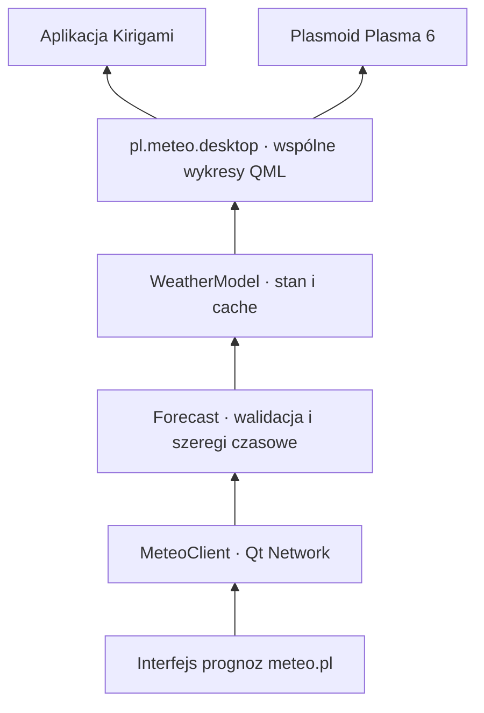

# Architektura

Wspólny backend C++ obsługuje aplikację okienkową i plasmoid. Inspiracją jest
podział odpowiedzialności z `btrfs-backup`, zwłaszcza wspólne modele prezentacji
i osobny pakiet integracji KDE. Pogoda nie wymaga procesu systemowego,
uprawnień roota ani pośrednictwa D-Bus.

| Katalog | Odpowiedzialność |
| --- | --- |
| `src/core` | Dokument prognozy, walidacja współrzędnych i obszaru modelu, wybór najnowszego uruchomienia |
| `src/network` | Asynchroniczne HTTP, timeout, limit odpowiedzi, anulowanie poprzedniego żądania |
| `src/presentation` | Stan QML, przeliczenie jednostek, podsumowanie najbliższej godziny, atomowy cache |
| `src/qml` | Wspólne wykresy, komunikaty stanu i edytor lokalizacji |
| `apps/meteo` | Okno Kirigami, preferencje użytkownika i wpis desktop |
| `integrations/plasma` | Pakiet Plasma 6, konfiguracja instancji i kompaktowa reprezentacja |
| `tests` | Parser, lokalny serwer HTTP, cache, renderowanie QML i start aplikacji |

## Przepływ danych

1. Model sprawdza cache przypisany do modelu i dokładnych współrzędnych.
2. Dla cache młodszego niż godzina, obejmującego bieżącą chwilę, nie powtarza
   automatycznego pobrania. Ręczne odświeżenie pomija ten warunek.
3. `GET /meteorograms/available` zwraca daty uruchomień. Adapter wybiera maksimum
   dla danego modelu niezależnie od kolejności elementów.
4. `POST /meteorograms/{model}` z `point.lat`, `point.lon` i `date` zwraca prognozę.
5. Parser sprawdza dane i osobne osie czasu wszystkich szeregów. Braki danych
   zachowuje jako `null`; nie zamienia ich w zero.
6. `WeatherModel` przelicza ciśnienie z Pa na hPa i zachmurzenie z ułamka na %.
   Opad jest podawany w mm dla przedziału prognozy. Nie zakłada godzinnego
   przedziału dla modeli o innej rozdzielczości czasowej.
7. Dopiero poprawna odpowiedź zastępuje stan i cache przez `QSaveFile`.

Zmiana lokalizacji anuluje poprzednie żądanie i usuwa poprzednie podsumowanie,
zanim rozpocznie się nowe pobranie. Licznik generacji odrzuca spóźnione odpowiedzi.
Jedna instancja `WeatherModel` obsługuje wszystkie wykresy danego widoku.

Cache jest wspólny dla procesów i zawiera model, współrzędne, czas pobrania
oraz oryginalny dokument. Klucz to SHA-256 modelu i współrzędnych.
Odczyt sprawdza również zawartość nagłówka i dokumentu. Awaria cache nie blokuje
pobrania ani wyświetlenia prognozy. Instancje uruchomione równocześnie mogą
wykonać osobne żądania; ta wersja nie współdzieli trwających pobrań między procesami.

## Weryfikacja

`ctest --preset dev` nie potrzebuje dostępu do serwisu meteo.pl. Testy HTTP
korzystają z lokalnego serwera TCP; testy interfejsu uruchamiają Qt w trybie
`offscreen`, z syntetyczną prognozą. Test aplikacji używa `--smoke-test`, który
wyłącza pobieranie. Test renderowania obejmuje wspólny panel używany przez obydwa
frontendy. Jeśli dostępny jest `plasmawindowed`, zestaw zawiera także test
uruchomienia pakietu plasmoidu. Zachowanie widgetu w panelu i zasobniku wymaga
osobnego sprawdzenia w sesji Plasma.
